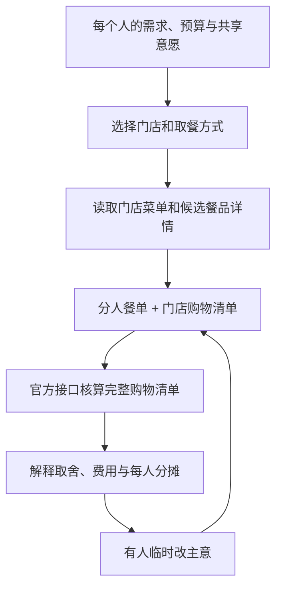

# MCP 接入与业务流程

## 官方服务

- Server：`https://mcp.mcd.cn`
- 提供方：麦当劳中国
- 传输：Streamable HTTP
- 认证：`Authorization: Bearer`，凭证从本机 `MCD_MCP_TOKEN` 注入
- 文档：[M-China/mcd-mcp-server](https://github.com/M-China/mcd-mcp-server)
- 联调实现：官方 `@modelcontextprotocol/client` SDK 2.3.1

Skill 读取用户需求，由宿主模型组织工具调用与餐单。每次调用的参数、标识和套餐组成以实时 `tools/list` 与业务工具返回为依据。

## 业务数据流

## 工具与业务价值

下表是 Skill 的调用设计。实际完成的调用及其结果单独记录在后面的实测部分。

| 工具 | 使用条件 | 对结果的影响 |
| --- | --- | --- |
| `now-time-info` | 确认当前日期与供应时段 | 为菜单和价格提供时间背景 |
| `query-nearby-stores` | 到店取餐或堂食 | 明确是哪家门店的餐品与价格 |
| `delivery-query-addresses` / `delivery-query-stores` | 用户选择外送 | 使用用户确认的配送地址和可配送门店 |
| `query-meals` | 已确定门店和场景 | 提供当次可选商品与代码 |
| `query-meal-detail` | 候选商品是套餐，或需要换选项 | 构建真实可购买的组合与分人关系 |
| `query-store-coupons` | 用户希望使用已有优惠 | 将当前账户、门店和场景的适用优惠纳入候选 |
| `calculate-price` | 购物清单确定，或发生改餐 | 返回整单金额，避免直接相加显示价或假设叠券 |
| `list-nutrition-foods` | 用户提出营养方面的要求 | 用官方数据解释对应餐品的营养信息 |

默认的配餐草案只涉及查询与算价。下单、支付、领券和积分兑换不是演示验收的一部分。

## 价格和分摊的边界

官方接口负责整单核价。Skill 负责餐品归属和分摊建议，两者分别展示。

共享套餐在购物清单中只计一份，各组件按约定分给对应成员。费用与无法定位到个人的整单优惠采用说明过的分摊方式；按金额最小单位计算并处理尾差，使个人金额合计等于官方整单应付金额。

## 实测状态

2026 年 10 月 14 日完成官方 MCP 真实联调，演示门店为麦当劳上海徐家汇餐厅（天钥桥路 1 号，`1450034`），场景为当前时段到店取餐。演示中的四名成员与需求是构造案例，门店、套餐选项和核价结果来自真实接口。

| 实际调用 | 观察结果 |
| --- | --- |
| `tools/list` | 成功发现 35 个工具，并读取本次所需工具的实时 schema |
| `now-time-info` | 返回北京时间 2026-10-14 17:22:22 |
| `query-nearby-stores` | 以公共关键词“上海 / 徐家汇”取得营业中的门店 |
| `query-meals` | 取得所选门店当前菜单，按实际返回的商品编码选餐 |
| `query-meal-detail` × 4 | 读取候选组合的轮次、可选餐品和差价；预算版追加使用大堡口福三件套 |
| `calculate-price`：初始清单 | 北京时间 21:23:09，官方返回 `price: 10030`，即 100.30 元 |
| `calculate-price`：改餐清单 | 北京时间 21:23:10，官方返回 `price: 10130`，即 101.30 元 |
| `calculate-price`：预算清单 | 北京时间 21:23:10，官方返回 `price: 6560`，即 65.60 元 |
| `calculate-price`：预算版改餐 | 北京时间 21:24:51，官方返回 `price: 6660`，即 66.60 元 |

首次联调在 17:22—17:24 完成，21:22 重新读取门店菜单与大堡口福三件套详情，随后取得上表四份核价响应。公开文件与网页使用这次更新的价格快照。

共享版改餐只将小周的高达吉士双牛堡换成麦香鱼。套餐内的无糖可乐保留，另外两条购物明细完全相同，官方整单价格增加 1.00 元。按示例约定，这 1.00 元由改餐者承担；改餐前后分摊总和分别为 100.30 元与 101.30 元。

预算版通过改变小林、小陈的汉堡并减少共享小食，将整单降到 65.60 元；同样的换鱼堡需求带入该方案后，整单 66.60 元。页面比较的是具体的四份已核价清单，分摊由案例中的 AA 约定产生。

公开复现材料：[完整案例](examples/live-run.md)、[初始请求](examples/quote-before.input.json)、[初始响应摘录](examples/quote-before.result.json)、[改餐请求](examples/quote-after.input.json)、[改餐响应摘录](examples/quote-after.result.json)、[预算请求](examples/quote-budget.input.json)、[预算响应](examples/quote-budget.result.json)、[预算改餐请求](examples/quote-budget-after.input.json)、[预算改餐响应](examples/quote-budget-after.result.json)、[套餐详情摘录](examples/meal-details.json)。响应摘录保留原始业务字段，移除了 trace ID 和重复的文本包装。

本次验证由开发过程中的模型按 Skill 流程通过官方 SDK 完成，覆盖公共门店查询、套餐选项、完整清单核价、单人改餐与分摊。外送、账户优惠券、营养查询及其他客户端安装尚未逐项实测；表中相应功能是流程支持范围。测试没有创建订单、领券或消费积分。

## 网页与 Skill 的职责

GitHub Pages 网页回放已保存的四份核价结果，用同一餐单状态生成分人视图、账单、群消息与 PNG 图片。网页不接收 Token、不发送用户输入、不创建订单。自由文本编辑器将用户原文与 Skill 执行要求组合成可复制任务；实时需求理解和 MCP 调用在用户自己的 AI 客户端进行。

## 凭证与公开材料

仓库配置示例只保留环境变量占位符。Token 在本机用于访问上述官方 Server。原始联调结果写入被 Git 忽略的 `private/` 目录；公开示例仅保留复核配餐所需的公共门店、餐品与金额摘要。
