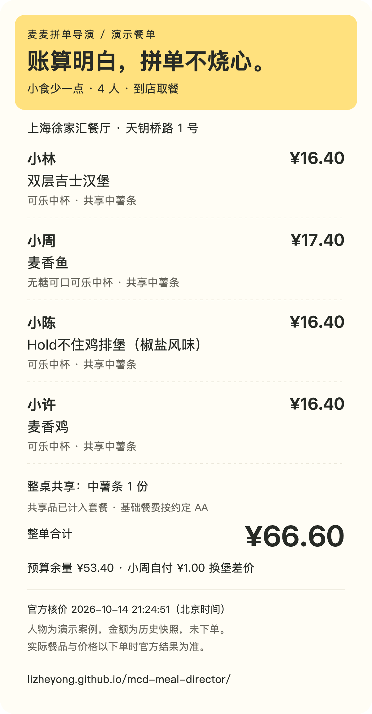

# 麦麦拼单导演 · Meal Director

**账算明白，拼单不烧心。**

把同事、朋友和家人的自然语言需求，变成有真实门店、真实餐品、整单核价和分摊建议的麦当劳多人餐单。

**[打开交互演示 →](https://lizheyong.github.io/mcd-meal-director/)** · [查看真实调用记录](examples/live-run.md) · [阅读 Skill](skills/mcd-meal-director/SKILL.md)

已完成官方 MCP 实测，附两种有明确取舍的四人餐单：

| 回放方案 | 初始整单 | 小周换麦香鱼后 | 共享小食 |
| --- | ---: | ---: | --- |
| 共享多一点 | ¥100.30 | ¥101.30 | 麦乐鸡 10 块 + 中薯条 1 份 |
| 小食少一点 | ¥65.60 | ¥66.60 | 中薯条 1 份 |

预算版省 ¥34.70，同时将小林的巨无霸换为双层吉士汉堡、小陈的板烧鸡腿堡换为椒盐风味鸡排堡，少了 10 块麦乐鸡。四人的饮料需求保留。四份金额均为 2026-10-14 上海徐家汇门店的真实接口核价快照，演示人物与需求为构造案例。

网页可以比较方案、试换麦香鱼、查看个人分摊和整单差价，并生成可复制的群餐单与 PNG 分享图。下方需求编辑器保留任意自然语言，整理成任务供已配置 Skill / MCP 的 AI 客户端执行；网页本身不调用模型或实时核价。

“拼单不烧心”借红果 AI 美食短剧的梗，指拼单安排与分摊省心。其他参赛作品的产品参考及 Claude Code 设计咨询见 [设计说明](DESIGN_NOTES.md)。

> “我们四个人，总共 120 元。小林不吃辣，小周不要含糖饮料，小陈想吃鸡肉，小许想跟大家分享小食。帮我们搭一顿，告诉每个人拿什么、多少钱。”
>
> “小周想换麦香鱼，无糖可乐保留，差价自己付。也看看小食少一点能省多少。”

## 它解决什么

拼单最费时间的地方，是把每个人的要求拼成**同一张真正可以买的订单清单**：套餐里谁拿汉堡、谁拿饮料，共享小食怎么买，改一杯饮料会不会影响套餐价格，最后大家各付多少。

麦麦拼单导演让模型理解这些关系，再用麦当劳中国官方 MCP 取得菜单和核价结果。

| 你说 | 它完成 |
| --- | --- |
| “四个人，不同口味，120 元以内” | 把需求对应到每个人，结合门店菜单安排餐品 |
| “这个套餐拆开分给两个人” | 区分分人餐单与门店购物清单，套餐只购买一次 |
| “大家分一份小食” | 标清参与共享的人与份数，分摊共享部分 |
| “一个人临时改主意” | 追踪受影响的套餐和优惠，重新核算整单与每人分摊 |
| “少花一点，需要改什么” | 逐一核价并对比餐品与共享数量的取舍 |
| “发给大家确认” | 给出可以直接转发的餐单，网页可下载 PNG 分享卡 |

主要面向工作室、办公室、朋友聚餐和家庭用餐的组织者。它运行在支持 Skill 和 MCP 的 AI 客户端里；模型负责需求理解、配餐和解释，官方 MCP 负责业务数据与价格。

## 快速开始：Codex CLI

准备好支持 MCP 的 Codex CLI、一个可用模型，以及你本人在 [麦当劳 MCP 开放平台](https://open.mcd.cn/mcp) 激活的 Token。使用下方联调脚本时另需 Node.js 22.9+。

### 1. 获取作品并安装 Skill

```sh
git clone https://github.com/lizheyong/mcd-meal-director.git
cd mcd-meal-director
mkdir -p .agents/skills
cp -R skills/mcd-meal-director .agents/skills/
```

从此目录启动 Codex，即可发现本项目的 Skill。也可以将技能目录安装到 `~/.agents/skills/`，供其他项目使用。

### 2. 接通官方 MCP

在终端运行第一行后，粘贴 Token 并回车；输入不会显示在终端，也不会成为一条 shell 历史命令。

```sh
read -rs MCD_MCP_TOKEN
export MCD_MCP_TOKEN
codex mcp add mcd-mcp --url https://mcp.mcd.cn --bearer-token-env-var MCD_MCP_TOKEN
codex
```

该环境变量仅对当前终端及从它启动的进程生效。图形客户端需要在其 MCP 设置中配置对应凭证。

进入 Codex 后用 `/mcp` 检查连接，并尝试：

```text
用 $mcd-meal-director 帮我们四个人安排麦当劳。
我们打算在上海徐家汇附近到店取餐，总预算 120 元。
小林不吃辣，小周不要含糖饮料，小陈想吃鸡肉，
小许希望大家分享一份小食。
先选门店，查真实菜单，给出分人餐单、整单核价和建议分摊。
这次只做配餐草案。
```

门店查询需要的位置信息由你提供；上面是公共地点的演示提示词。实际查询结果可能要求补充具体门店或定位。

### 3. 看这几个结果

- 每个人的关键需求都有餐品对应，共享份数清楚。
- 门店购物清单使用接口返回的可售餐品与套餐选项。
- 整单应付金额来自 `calculate-price`，并标出核价时间。
- 每人建议分摊合计等于整单金额。
- 临时换餐后，明确展示餐品变化与重算结果。

价格、可售商品、优惠与时段可能变化，以实际下单时官方结果为准。

## 其他 Skill / MCP 客户端

将 [skills/mcd-meal-director](skills/mcd-meal-director) 导入客户端的技能目录，使用 [mcp-config.example.json](mcp-config.example.json) 对照配置官方 Streamable HTTP 服务。示例凭证只包含环境变量占位符，客户端需要自行支持变量展开；不支持时，在本地凭证设置中填写真实 Token。

本作品的运行逻辑在 [SKILL.md](skills/mcd-meal-director/SKILL.md) 中。客户端可以自行选择模型，本项目不附带模型 API Key，也不要求额外的应用后端。

## 可复现的接口联调

已连接原生 MCP 的客户端可以直接调用工具。仓库另附一个小型 CLI，用官方 MCP SDK 复现接口调用和检查实时参数。

```sh
npm ci --ignore-scripts
npm run mcp -- list
npm run mcp -- schema query-nearby-stores
npm run mcp -- call now-time-info
```

带参数调用时，将根据实时 schema 准备的参数存入本地 JSON 文件：

```sh
npm run mcp -- call query-nearby-stores private/nearby.json
```

CLI 从环境变量或仓库根目录的本地 `.env` 读取 `MCD_MCP_TOKEN`，输出带采集时间的原始工具结果。`.env` 和 `private/` 已加入忽略列表。`call` 会执行指定工具；演示使用查询和算价工具，公开材料只保留不含凭证、个人资料或账户标识的必要摘录。

## 开发与验证

运行 `npm test`，核对页面与分享内容使用的金额、官方响应和换堡前后的归属。用 `python3 -m http.server 8767 --bind 127.0.0.1 --directory docs` 在本机预览网页。

<details>
<summary>查看页面生成的分享卡示例</summary>



</details>

## 项目结构

```text
docs/                            方案回放、分享卡与任务编辑器
tests/meal.test.mjs               官方响应、分摊与套餐选择核对
skills/mcd-meal-director/SKILL.md   配餐、改餐与分摊流程
skills/mcd-meal-director/agents/   Codex 技能展示信息
scripts/mcp.mjs                   官方 MCP SDK 联调入口
mcp-config.example.json          仅含占位符的 MCP 配置
MCP_INTEGRATION.md               工具、数据流与实测记录
CONTEST_DECLARATION.md           官方参赛声明原件
```

## 参赛与许可

本项目已获得[主办方成功参赛确认](https://github.com/M-China/mcd-developer-innovation-challenge/issues/689#issuecomment-6165769862)，参加 [麦当劳程序员创意开发大赛](https://github.com/M-China/mcd-developer-innovation-challenge)。它是独立开发的参赛作品，非麦当劳官方产品。官方参赛声明保留原文；项目原创代码与指令采用 MIT 许可。麦当劳服务、商标和官方材料适用各自的条款。

参考：[麦当劳 MCP 工具文档](https://github.com/M-China/mcd-mcp-server)、[Codex MCP](https://learn.chatgpt.com/docs/extend/mcp?surface=cli)、[Codex Skills](https://learn.chatgpt.com/docs/build-skills)。
